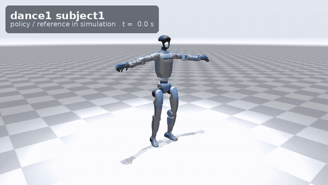
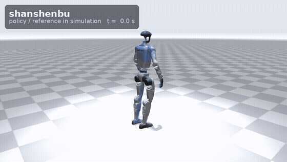
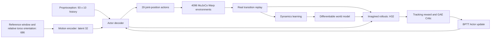

# Godot SuperMimic · Unitree G1

[中文说明](README.zh-CN.md) · [Models](models/README.md) · [Measurements](docs/performance.md) · [Attribution](THIRD_PARTY_NOTICES.md)

Reference-conditioned whole-body tracking for the 29-DoF Unitree G1, trained on a single RTX 5070 Laptop GPU. The training loop learns a differentiable world model and updates the Actor through imagined rollouts with BPTT and a learned Critic.

This repository contains Godot's integrated training implementation, best local checkpoints, reproducible evaluation reports and real closed-loop simulation recordings. Code provenance and required third-party notices are documented separately. It does not contain other locomotion frameworks, source videos or local workstation configuration.

| LAFAN1 tracking | Shanshenbu specialist / 闪身步 |
| --- | --- |
|  |  |
| [MP4: dance, running and jumps](media/lafan1.mp4) | [MP4: all six specialist motions](media/shanshenbu.mp4) |

Solid robot: trained policy; translucent blue robot: reference. These are simulation recordings, not hardware demonstrations. LAFAN videos show bounded excerpts; complete quantitative evaluation is reported below. [Individual videos and recording details](media/README.md).

## Results

| Released best model | Best control-step counter | Reference set | Whole clips completed | Mean full-clip normalized return |
| --- | ---: | --- | ---: | ---: |
| LAFAN1 | 125000 | 40 training clips | **40/40** | **0.847032** |
| Six-motion specialist | 2000 new steps | 6 custom training clips | **6/6** | **0.838217** |

The specialist is initialized from the LAFAN1 model. On its target six motions, the initial baseline was **0.754944** and the best after 2000 new control steps was **0.838217**. Each prospective best uses full-clip evaluation, with two confirmations and the worse score retained. These are training-set results; different datasets are not a shared leaderboard. Normalized reward is not a percentage of human-motion similarity.

## Current training architecture

The published models use a learned differentiable world model, a reference-conditioned Actor and a GAE-trained Critic. Real simulation transitions fit the dynamics model. Actor updates unroll the model for 32 steps and differentiate tracking returns through those predicted states; model parameters remain frozen during that Actor update.



| Component | Actual released architecture |
| --- | --- |
| Motion encoder | `686 → 2048 → 1024 → 512 → 256 → 32` |
| Actor decoder | `(930 history + 32 latent) → 2048 → 1024 → 512 → 256 → 29` |
| Dynamics network | `133 → 2048 → 2048 → 2048 → 70 residual values`, integrated to the 71-value next state; hidden LayerNorm |
| Critic | `794 → 256 → 128 → 1`; training-only state/context/root-error inputs |
| Approximate trainable parameters | Actor **8.90 M**, world model **8.83 M**, Critic **0.237 M** |
| Normalization | Saved RunningNorm for Actor/Critic and dynamics; statistics are frozen for inference |

The Actor receives a 689-value transported goal; its three positional feedback values are removed before the 686-value encoder input. Training-only simulator state and context are not hardware Actor inputs. Optional AMP adds a discriminator reward to imagined tracking rollouts; it is disabled in both published best checkpoints.

## Hardware, training budget and elapsed time

| Item | Measured / saved configuration |
| --- | --- |
| GPU | **NVIDIA GeForce RTX 5070 Laptop GPU, 8 GiB class**, one GPU |
| CPU | **AMD Ryzen 9 8945HX with Radeon Graphics**; training launcher limits PyTorch/BLAS to two CPU threads per process |
| Host runtime | Linux x86-64 under WSL2; about **15.27 GiB visible WSL RAM**, not a claim about total host physical RAM |
| Software | Python 3.12.15, PyTorch 2.9.1/cu128, mjlab 1.6.0, MuJoCo / MuJoCo Warp 3.11.0, Warp 1.14.0 |
| Collection / control | **4096 environments**, 0.005 s physics timestep, decimation 4, **50 Hz** control |
| World-model learning | Window 8; **512 samples × 10 batches** per update; LR `2e-5` |
| Actor / Critic learning | **H32**, batch **256**; Actor LR `2e-6`, Critic LR `2e-5`; `gamma=0.99`, `lambda=0.95` |
| Update schedule | 40 control-step warm-up; target 0.4 optimization updates per vectorized control step; cosine learning-rate decay |
| Published best precision | FP32, eager execution; EMA and AMP auxiliary rewards disabled |

| Recorded training segment | Counter range / selected best | Elapsed wall time | Peak PyTorch allocated GPU memory |
| --- | --- | ---: | ---: |
| Final LAFAN1 continuation stage | `106000 → 126000`; selected `125000` | **45095.9 s / 12 h 31 min 36 s** | **4.615 GiB** |
| Six-motion specialist | `0 → 2000` new steps; selected `2000`, 784 updates | **3821.5 s / 1 h 3 min 41 s** | **4.089 GiB** |

The 12.53-hour figure covers only the final 20000-step LAFAN1 stage, including its recorded training/evaluation workflow. It is **not** the total cost of reaching 125000 from scratch. Complete historical training time has not been reconstructed. CUDA allocation is PyTorch's peak allocated memory; it excludes non-PyTorch simulation/driver allocations. [Observed hardware](results/hardware.json), [raw training records](results/lafan1_resources.json) and [specialist records](results/skills_resources.json) provide the precise measurement scope.

| Specialist reference | Before fine-tuning | After 2000 steps |
| --- | ---: | ---: |
| Shanshenbu / 闪身步 | 0.809823 | 0.903524 |
| Pro turning/jumping | 0.644683 | 0.705568 |
| Four-motion sequence | 0.751722 | 0.829380 |
| Gouxiong duosuomao | 0.660743 | 0.798788 |
| Langzi tiqiu | 0.831857 | 0.921776 |
| Yaotou huangnao | 0.830833 | 0.870268 |

Reports: [LAFAN1 best](results/lafan1_best.json), [specialist baseline](results/skills_baseline.json), [specialist best](results/skills_best.json). Full checkpoints, including optimizers, are [Release assets](https://github.com/waitingforgodo/supermimic_reproduction_by_godot/releases/tag/v0.1.0); [checksums and download manifest](models/manifest.json) are versioned in Git.

## What is integrated

- Real-data Actor/Critic normalization, dynamics input/output normalization and hidden LayerNorm.
- Relative torso orientation feedback without robot position feedback: **930 history values + 686 effective goal values**, producing 29 joint-position actions.
- Cached-body reference alignment for the imagined reward and horizon-normalized reset sampling with visit-count initialization / per-clip hard caps.
- Independent Actor/Critic learning rates, network-only initialization for new motions, strict same-data resume and full-clip best-checkpoint retention.
- Finite-value checks, atomic checkpoint writes and explicit model/data hashes.
- Optional EMA, replay indexing cache and experimental BF16 weight caching. A same-budget short comparison measured a **9.6% reduction in paired update time** and **4.2% lower peak PyTorch allocation**; it did not improve the tracking score. [Method and limits](docs/performance.md).
- Optional AMP-style auxiliary reward through the world model. It retains reference tracking and has passed bounded training/resume checks; it is **not enabled in the released best models** and has no demonstrated long-run quality gain yet.

## Installation

Tested: Linux / WSL2, Python 3.12, PyTorch 2.9.1 + CUDA 12.8, mjlab 1.6.0, MuJoCo/MuJoCo Warp 3.11.0, Warp 1.14.0. The CUDA driver must support the selected PyTorch wheel.

```bash
git clone https://github.com/waitingforgodo/supermimic_reproduction_by_godot.git
cd supermimic_reproduction_by_godot
python3.12 -m venv .venv
source .venv/bin/activate
python -m pip install --upgrade pip
python -m pip install torch==2.9.1 --index-url https://download.pytorch.org/whl/cu128
python -m pip install -e ".[dev]"
```

`bash g1.sh ...` selects `.venv/bin/python` when available; `G1_PYTHON=/path/to/python` selects another prepared environment. `g1-supermimic ...` is the equivalent installed console command. Runtime output and downloaded LAFAN data are ignored by Git.

## Download models and references

```bash
bash g1.sh models                 # verified LAFAN1 + specialist bundles
bash g1.sh prepare                # separately download and convert 40 LAFAN1 clips
```

The six custom robot references are included under `data/skills/`. LAFAN1 is not redistributed; the downloader pins its source revision. Read [data provenance and terms](data/README.md) before using it. Converter source-path metadata and ZIP timestamps are excluded from the motion-content hash; numerical trajectory changes still invalidate normal resume.

## Replay and evaluate

```bash
# LAFAN1 browser viewer: http://localhost:8081
bash g1.sh play --checkpoint models/lafan1/best.pt --viewer viser --port 8081

# Specialist motion menu: http://localhost:8082
bash g1.sh showcase --checkpoint models/skills/best.pt --port 8082

# Full-clip evaluation of each model on its own reference set.
bash g1.sh evaluate --checkpoint models/lafan1/best.pt --envs 40 \
  --output outputs/evaluation_lafan1.json
bash g1.sh evaluate --checkpoint models/skills/best.pt --envs 6 \
  --output outputs/evaluation_skills.json
```

To replay one new motion, make the changed reference set explicit:

```bash
bash g1.sh play --checkpoint models/skills/best.pt \
  --motion data/skills/shanshenbu.npz --allow-new-motion --port 8081
```

This flag describes a changed inference reference set; it does not turn a training-set clip into an unseen generalization result.

## Train, specialize and resume

```bash
# Check the actual saved LAFAN recipe before a new training run.
bash g1.sh train --config configs/lafan1.json --dry-run
bash g1.sh train --config configs/lafan1.json --name lafan1_training

# Initialize from LAFAN weights on a new target dataset; reset optimizers/counters.
bash g1.sh train --init-from models/lafan1/best.pt --npz-dir data/skills \
  --config configs/skills.json --iterations 20000 --stop-after-steps 2000 \
  --save-interval 500 --name skills_finetune

# Resume the specialist with its saved networks, optimizers and data contract.
bash g1.sh resume --checkpoint models/skills/best.pt \
  --iterations 20000 --name skills_continue

# Optional experimental AMP shaping, on the existing tracking interface.
bash g1.sh train --init-from models/skills/best.pt --npz-dir data/skills \
  --config configs/skills_style_amp.json --iterations 20000 \
  --stop-after-steps 2000 --save-interval 500 --name skills_amp_pilot
```

`--iterations` is the **target total vectorized control-step counter**, not the PPO update count. `--stop-after-steps` limits additional control steps without rescaling the learning-rate schedule. `--init-from` initializes a new task; `resume` restores the same task and rejects changed motion content/order. Only the confirmed best checkpoint is retained in each run.

## Save videos and GIFs

```bash
bash g1.sh record --checkpoint models/lafan1/best.pt \
  --clips dance1_subject1 run1_subject2 jumps1_subject1 \
  --seconds 12 --output outputs/lafan1_demo
bash g1.sh record --checkpoint models/skills/best.pt \
  --clips shanshenbu shanshenbu_pro --output outputs/skills_demo
```

Recording runs the actual closed-loop Actor and stops each clip on termination/end. Rendering writes per-clip MP4, a concatenated MP4 and a bounded GIF. The default headless renderer uses OSMesa (`libosmesa6` on Ubuntu); set `MUJOCO_GL=egl` for a working EGL setup. `imageio-ffmpeg` supplies the encoder, so a system `ffmpeg` command is optional.

## Validation and scope

```bash
CUDA_VISIBLE_DEVICES='' python -m unittest discover -s tests -p 'test_*.py' -v
PYTEST_DISABLE_PLUGIN_AUTOLOAD=1 CUDA_VISIBLE_DEVICES='' python -m pytest tests/core -q
```

[Release validation](results/release_validation.json) records the executed checks. Publication preserves every trained tensor and optimizer state; portable metadata is separately documented in [model export validation](results/model_export_validation.json).

The Actor uses joint feedback, pelvis angular velocity, projected gravity, previous actions, a stored reference window and relative torso orientation. It does not require measured global position or base linear velocity. IMU/waist kinematics, yaw alignment, timing, actuator mapping and a real control bridge still need hardware validation. `deploy` currently reuses simulation playback. [Observation and deployment contract](docs/observations.md).

Code is MIT with retained [third-party notices](THIRD_PARTY_NOTICES.md). Motion data, robot assets and demonstration media have their own terms. See [LICENSE](LICENSE).
