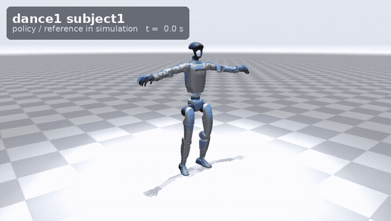
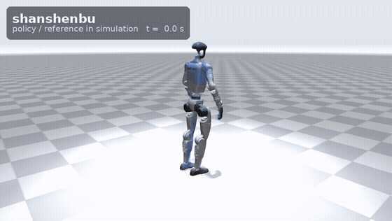
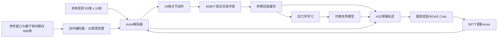

# Godot SuperMimic · G1 全身动作跟踪

[English](README.md) · [模型下载](models/README.md) · [性能测试](docs/performance.md) · [第三方声明](THIRD_PARTY_NOTICES.md)

本仓库只包含我的 SuperMimic 训练实现、改进配置、最优训练结果和闭环仿真演示。训练采用**可微世界模型＋BPTT Actor/Critic**，支持 29 自由度 Unitree G1 的参考动作跟踪。开源版本已整理成独立 Python 项目，不依赖原来的多框架工作区或本机目录。

| LAFAN1 动作跟踪 | 闪身步专项 |
| --- | --- |
|  |  |
| [舞蹈、跑步、跳跃 MP4](media/lafan1.mp4) | [六动作完整演示 MP4](media/shanshenbu.mp4) |

实体机器人是策略闭环输出，蓝色半透明机器人是参考动作。这些是仿真视频；LAFAN 视频是片段展示，完整评测结果另行记录。[分动作视频与录制说明](media/README.md)。

## 训练结果

| 最优模型 | 最佳控制步 | 参考动作 | 整段完成 | 平均整段归一化回报 |
| --- | ---: | ---: | ---: | ---: |
| LAFAN1 通用跟踪 | 125000 | 40 段 | **40/40** | **0.847032** |
| 六动作专项 | 新增 2000 步 | 6 段 | **6/6** | **0.838217** |

六动作专项从 LAFAN 模型初始化，在同一目标集上，0 步基线 **0.754944 → 2000 步最优 0.838217**。闪身步单段为 **0.809823 → 0.903524**。完整六动作逐项结果见英文首页及 [原始报告](results/skills_best.json)。两组数据不同，不横向排名；归一化奖励也不是百分制动作相似度。这里报告训练集表现，尚未证明未见动作上的泛化提升。

## 当前训练架构

核心为**可微世界模型＋BPTT Actor/Critic**：从真实仿真采集转移数据来训练动力学；Actor 在冻结参数的世界模型中展开 32 步，通过跟踪回报对动作反向传播；Critic 使用 GAE 目标单独学习价值。



| 模块 | 实际发布结构 |
| --- | --- |
| 动作目标编码器 | `686 → 2048 → 1024 → 512 → 256 → 32` |
| Actor 解码器 | `930维历史＋32维潜变量 → 2048 → 1024 → 512 → 256 → 29` |
| 动力学网络 | `133 → 2048 → 2048 → 2048 → 70维残差`，积分得到 71 维下一状态；隐层 LayerNorm |
| Critic | `794 → 256 → 128 → 1`；含训练专用状态、环境上下文与根部误差 |
| 参数量约数 | Actor **8.90M**、世界模型 **8.83M**、Critic **0.237M** |
| 归一化 | Actor/Critic 和动力学使用保存的 RunningNorm；回放时冻结统计 |

环境传递 689 维目标，进入编码器前去掉 3 维相对位置，因此有效目标为 686 维。真值状态和环境上下文只用于训练，不能误当成真机 Actor 的传感输入。AMP 风格奖励是可选的训练辅助分支，本次发布的两个最优模型均未启用。

## 实测硬件、训练配置与时长

| 项目 | 实测或已保存配置 |
| --- | --- |
| GPU | 单张 **NVIDIA GeForce RTX 5070 Laptop GPU，8 GiB 级显存** |
| CPU | **AMD Ryzen 9 8945HX with Radeon Graphics**；启动器把每进程 PyTorch/BLAS 线程限制为 2 |
| 系统 | Linux x86-64 / WSL2；WSL 可见内存约 **15.27 GiB**，不是整机物理内存规格 |
| 软件 | Python 3.12.15、PyTorch 2.9.1/cu128、mjlab 1.6.0、MuJoCo / MuJoCo Warp 3.11.0、Warp 1.14.0 |
| 仿真采集 | **4096 环境**；物理步长 0.005 s，decimation=4，控制频率 **50 Hz** |
| 世界模型更新 | 窗口 8；**batch512 × 10 批**；学习率 `2e-5` |
| Actor / Critic | **H32、batch256**；学习率分别 `2e-6 / 2e-5`；`gamma=0.99`、`lambda=0.95` |
| 更新日程 | 热身 40 控制步；每向量化控制步目标 0.4 次优化更新；余弦衰减 |
| 发布权重精度 | FP32 / eager；EMA 和 AMP 辅助项关闭 |

| 有完整记录的训练阶段 | 步数范围及最优点 | 实际墙钟时长 | PyTorch 峰值已分配显存 |
| --- | --- | ---: | ---: |
| LAFAN1 最后一次续训阶段 | `106000 → 126000`，选中 `125000` | **45095.9 秒 / 12小时31分36秒** | **4.615 GiB** |
| 六动作专项 | 新任务 `0 → 2000`，选中 `2000`，784 次更新 | **3821.5 秒 / 1小时3分41秒** | **4.089 GiB** |

**12.53 小时只对应最后新增的 20000 步，不是从零训练到 125000 步的总耗时。**完整历史训练总时长尚未追溯完成；这里保留阶段记录的训练与评测流程耗时。显存数字为 PyTorch 已分配峰值，不包含全部仿真库和驱动占用。[硬件采样](results/hardware.json)、[LAFAN 原始记录](results/lafan1_resources.json)、[专项原始记录](results/skills_resources.json)。

每次候选执行整段评测，潜在最优需双次确认并取较差结果。发布的是实际保存的最优模型，不是最后一次模型或仅按训练奖励挑选的模型。完整文件含世界模型、Actor、Critic 和优化器，保存在 [v0.1.0 Release](https://github.com/waitingforgodo/supermimic_reproduction_by_godot/releases/tag/v0.1.0)。

## 主要改进

- Actor/Critic 的真实观测归一化，世界模型输入输出归一化及隐层 LayerNorm。
- 躯干相对朝向反馈，去掉 Actor 的相对位置反馈；有效输入为 930 维历史观测与 686 维目标。
- 想象奖励的参考刚体对齐、按预测时域归一化的回报采样、访问计数初始化和难片段占比限制。
- Actor/Critic 独立学习率；新动作仅继承网络权重的初始化；同数据严格恢复；整段评测选优。
- 有限值检查、原子保存、完整模型/动作数据校验；发布版使用跨目录可复现的动作内容哈希。
- 可选 EMA、采样索引缓存及实验性 BF16。相邻同预算短测中，配对更新时间降低 **9.64%**，峰值 PyTorch 已分配显存降低 **4.21%**；没有证明提分或长期收敛收益。[测试范围](docs/performance.md)。
- 可选动作跟踪＋AMP 风格辅助奖励，已验证训练、梯度、保存和恢复；**本次发布的两个最优模型均未启用 EMA/BF16/AMP 辅助项**。

## 安装与下载

已测试环境：Linux / WSL2、Python 3.12、PyTorch 2.9.1/cu128、mjlab 1.6.0、MuJoCo / MuJoCo Warp 3.11.0、Warp 1.14.0。

```bash
git clone https://github.com/waitingforgodo/supermimic_reproduction_by_godot.git
cd supermimic_reproduction_by_godot
python3.12 -m venv .venv
source .venv/bin/activate
python -m pip install --upgrade pip
python -m pip install torch==2.9.1 --index-url https://download.pytorch.org/whl/cu128
python -m pip install -e ".[dev]"

bash g1.sh models
bash g1.sh prepare
```

`models` 下载并校验本仓库 Release 的两份模型；只要专项模型可用 `models --only skills`。`prepare` 另外下载固定版本 LAFAN1 并做 30→50 Hz 转换，数据本身不随 Git 或模型压缩包分发。六动作机器人参考已包含在 `data/skills/`。[动作来源与使用条件](data/README.md)。

## 回放和评测

```bash
bash g1.sh play --checkpoint models/lafan1/best.pt --viewer viser --port 8081
bash g1.sh showcase --checkpoint models/skills/best.pt --port 8082

bash g1.sh evaluate --checkpoint models/lafan1/best.pt --envs 40 \
  --output outputs/evaluation_lafan1.json
bash g1.sh evaluate --checkpoint models/skills/best.pt --envs 6 \
  --output outputs/evaluation_skills.json

# 单独指定片段会改变模型保存的整套参考列表，因此显式允许该推理操作。
bash g1.sh play --checkpoint models/skills/best.pt \
  --motion data/skills/shanshenbu.npz --allow-new-motion --port 8081
```

## 训练与继续强化

```bash
bash g1.sh train --config configs/lafan1.json --dry-run
bash g1.sh train --config configs/lafan1.json --name lafan1_training

# 从 LAFAN 权重创建六动作专项，先训练 2000 步并完成最终候选评测。
bash g1.sh train --init-from models/lafan1/best.pt --npz-dir data/skills \
  --config configs/skills.json --iterations 20000 --stop-after-steps 2000 \
  --save-interval 500 --name skills_finetune

# 同数据续训：继承网络、优化器与计数。
bash g1.sh resume --checkpoint models/skills/best.pt \
  --iterations 20000 --name skills_continue

# 单独的实验：现有动作跟踪＋AMP 风格奖励。
bash g1.sh train --init-from models/skills/best.pt --npz-dir data/skills \
  --config configs/skills_style_amp.json --iterations 20000 \
  --stop-after-steps 2000 --save-interval 500 --name skills_amp_pilot
```

`--iterations` 是**目标累计的向量化控制步计数**；`--stop-after-steps` 是本次额外运行上限，不改变学习率总日程。`--init-from` 创建新任务并重置优化器与计数，`resume` 则要求同一套动作内容/顺序。每个训练目录只保留经过确认的最佳模型。

## 保存 GIF 和视频

```bash
bash g1.sh record --checkpoint models/lafan1/best.pt \
  --clips dance1_subject1 run1_subject2 jumps1_subject1 \
  --seconds 12 --output outputs/lafan1_demo
bash g1.sh record --checkpoint models/skills/best.pt \
  --clips shanshenbu shanshenbu_pro --output outputs/skills_demo
```

输出包含实际策略轨迹、录制参数、分片 MP4、合辑 MP4 和 GIF。默认使用 OSMesa 离屏渲染，Ubuntu 可安装 `libosmesa6`；有可用 EGL 时可指定 `MUJOCO_GL=egl`。编码器由 `imageio-ffmpeg` 提供，不强依赖系统 `ffmpeg` 命令。

## 测试及真机边界

```bash
CUDA_VISIBLE_DEVICES='' python -m unittest discover -s tests -p 'test_*.py' -v
PYTEST_DISABLE_PLUGIN_AUTOLOAD=1 CUDA_VISIBLE_DEVICES='' python -m pytest tests/core -q
```

[发布验证记录](results/release_validation.json) 与 [权重导出核对](results/model_export_validation.json) 提供具体证据。代码 MIT，第三方署名和数据/媒体许可另见 [声明](THIRD_PARTY_NOTICES.md)。

Actor 的传感输入可以由关节编码器、骨盆 IMU、上一拍动作及本地参考构造。躯干姿态需要腰部正运动学与航向对齐，不需要实际全局位置或基座线速度。本仓库尚无经过验证的 DDS 真机控制器，`deploy` 仍是仿真回放。[观测与部署契约](docs/observations.md)。
